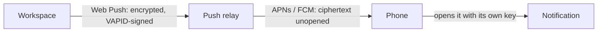

# Push notifications

The workspace can tell its apps about new mail with a push notification. Push is optional and off by default. It is on only while `PUSH_RELAY_URL` (a var in `wrangler.jsonc`) names a **push relay**: a small Worker in [`relay/`](../relay/README.md) that holds an app's Apple and Google keys and passes each notification on to the phone.

## Why a relay

Apple delivers a notification to an app only from a server that holds that app's APNs key, and Google only from one with access to its Firebase project. A self-hosted workspace does not hold those keys for apps someone else builds, and should not: anyone with the key can notify every phone that runs the app. The relay keeps them in one place, and each workspace talks to it in plain [Web Push](https://www.rfc-editor.org/rfc/rfc8030), the protocol a browser's push service speaks:



- **The relay cannot read a notification.** The workspace encrypts every message for the subscription's own key ([RFC 8291](https://www.rfc-editor.org/rfc/rfc8291), `aes128gcm`). The relay hands the ciphertext to Apple or Google as it is, and the app's notification extension opens it on the phone. Apple and Google see only the ciphertext and the placeholder alert (`ALERT_TITLE`, `ALERT_BODY`).
- **The relay stores nothing.** An endpoint *is* its device: the platform, the device token and the workspace's VAPID key, sealed with AES-GCM under the relay's `RELAY_SECRET`. The relay has no table to leak, and a workspace never learns a device token.
- **An endpoint is bound to one workspace.** Every push carries the workspace's [VAPID](https://www.rfc-editor.org/rfc/rfc8292) signature, and the relay refuses a push signed by any key other than the one sealed into the endpoint. A leaked endpoint is useless to anyone else.
- **Without a relay, nothing changes.** With `PUSH_RELAY_URL` empty, `GET /api/v1/push` answers `enabled: false`, subscriptions are refused, and filing mail never reaches out.

Anyone can run a relay. An app's builder runs one with that app's keys, and every workspace whose people use the app sets `PUSH_RELAY_URL` to it. Someone who builds their own apps runs their own relay ([relay/README.md](../relay/README.md)).

## What is sent

A notice goes out when a message reaches a person's inbox and is news: the conversation is in the inbox, unread, not muted and not snoozed. Spam, mail a filter archived or marked read, an import's history and the person's own sent mail send nothing. A group's shared inbox has no sessions of its own, so it sends nothing either; a distribution group's members each hear of their own copy.

The message the app opens is JSON, a few hundred bytes:

```json
{
  "type": "mail",
  "title": "Ada Lovelace",
  "body": "Lunch on Friday?",
  "threadId": "th_…",
  "url": "https://workspace.example.com/mail/t/th_…"
}
```

`title` is the sender's name, or their address when it has none, cut at 100 characters. `body` is the subject, cut at 200. `type` names the kind of notice: an app ignores a type it does not know, so later releases can add more. The push's `Topic` is the conversation's id, so a second message in the same conversation replaces the notice of the first if that one is not shown yet. The `TTL` is a day.

## For an app

1. Sign in through the API ([docs/API.md](API.md)) and read `GET /api/v1/push`, which answers `{ enabled, relay, applicationServerKey }`. Stop here while `enabled` is false.
2. Ask the system for a device token (APNs, or FCM's registration token), then register it with the relay: `POST <relay>/v1/register` with `{ "platform": "apns" | "fcm", "token": "<device token>", "environment": "production" | "development", "applicationServerKey": "<from step 1>" }`. `environment` is Apple's: `development` for a build signed for development, whose token belongs to APNs' sandbox. The relay answers `201 { "endpoint": "https://…/v1/push/v1.…" }`.
3. Make a P-256 ECDH key pair and 16 random bytes, the subscription's `p256dh` and `auth`, and keep the private key in the Keychain (or Android's Keystore) where the notification extension can read it.
4. Subscribe: `POST /api/v1/push/subscriptions` with `{ "endpoint": "<from step 2>", "keys": { "p256dh": "<base64url, 65 bytes>", "auth": "<base64url, 16 bytes>" } }`, the shape of a browser's `PushSubscription.toJSON()`. It answers `201 { ok: true, id }`. A session holds one subscription, so subscribing again replaces it.
5. On iPhone, a notification arrives with `mutable-content` and the ciphertext in `wp` (base64url). The app's Notification Service Extension opens it as RFC 8291 §3 says: the salt, record size and sender's key from the first 86 bytes, then ECDH with the private key from step 3, the two HKDF steps and AES-128-GCM, then strip the padding before the final `0x02` delimiter. It shows `title` and `body` and keeps `threadId` for the tap. On Android, the message is a data message with `wp` in `data`, and the app opens it and shows the notification itself. `test/push.test.ts` (`openPush`) is a complete receiver in about thirty lines.
6. Do steps 1 to 4 again each time the app comes to the front: a device token, the workspace's key or the relay's secret can change. Signing out deletes the session, and the subscription goes with it. `DELETE /api/v1/push/subscriptions/:id` removes it without signing out.

## In the workspace

- `app/lib/push/web-push.server.ts` is Web Push in WebCrypto alone: `encryptPush` (RFC 8291, which `test/push.test.ts` holds to the RFC's own example byte for byte), `vapidAuthorization` (RFC 8292) and `sendPush`.
- `app/lib/push/push.server.ts` holds the rest: `pushRelayOrigin` (on only for an `https:` address), the VAPID key (`vapidKey`: made on first use and kept in `workspace_settings` as `push.vapid-key`, its private half sealed with `sealSecret` under purpose `push-vapid-key`), `subscribe` and `unsubscribe`, `pushToPerson` and `notifyNewMail`, which `fileInMailbox` in `ingest.server.ts` calls once a message is filed and judged not spam. A push that fails is logged (`push.failed`, `push.mail` with the counts) and never fails the delivery. A subscription the relay answers 404 or 410 for is deleted.
- A subscription is a row of `push_subscriptions`, tied to its session (`ON DELETE CASCADE`): signing out, a new password, a deactivation and a removal all end it through `revoke`, with no code of their own. `subscribe` takes only an endpoint under `<PUSH_RELAY_URL>/v1/push/`, so the workspace never posts anywhere an app names.
- Rotating `SESSION_SECRET` loses the VAPID key's private half. The workspace then makes a new key and deletes every subscription, since the relay would refuse the new key's pushes on them; the apps subscribe again when `GET /push` names another key.
- The API's routes are `app/lib/api/push.server.ts`. A route reads its session's id from `ApiContext.sessionId`.
